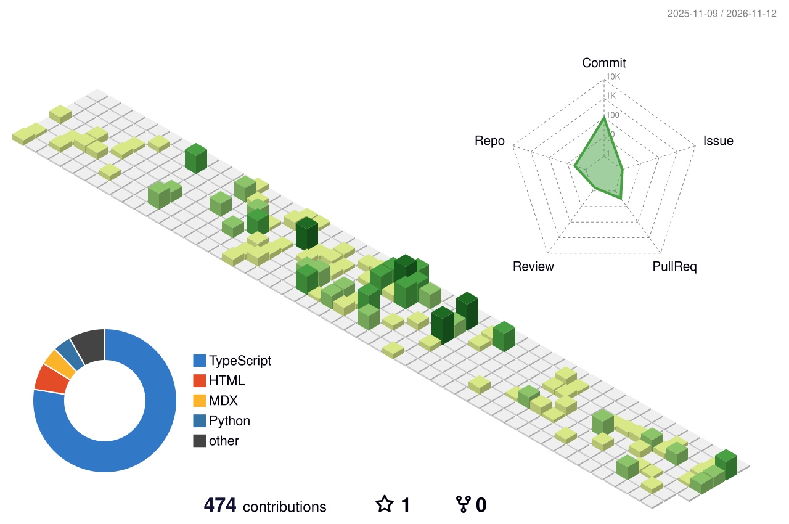

  
  

    
    <strong>I'm currently focusing on LLM agents and agent evaluation.</strong>
  

  

    <code>🎓 UNSW Master of IT · BSc in Finance</code>
    <code>📍 Based in Sydney, Australia</code>
  

<table>
<tr>
<td valign="top" width="50%">

#### 💼 Work Experience

<strong>Sigma Trading Management</strong> -- <code>AI Agent & Full-Stack</code> -- <code>2026.1 – Present</code> 
<strong>Euler AI</strong> -- <code>RAG & LLM Evaluation</code> -- <code>2025.7 – Present</code> 

#### 🚀 Featured Project
- **[Velo](https://github.com/TSK-Glofy/Velo)** — Open-source FFmpeg desktop app (Tauri 2 · Rust · TypeScript)

</td>
<td valign="top" width="50%">

#### 📄 Research

- **[WSDM 2027](https://wsdm-conference.org/2027/) (Accepted)** — *ECHO: Decoding Answers, Not Programs, for Knowledge Base Question Answering*
- **[ADC 2026](https://adc-conference.github.io/2026/) (Accepted)** — *Robust Forex Fraud Detection under Noisy Supervision via Label-Quality-Aware Learning*
- **[FAIML 2026](https://www.faiml.org/) (Accepted)** — *When Gender Becomes Visible: Benchmarking Fairness in LLM-Based Resume Screening*
</td>
</tr>
</table>

## Contribution

## Leetcode Stats

## Profile View
Counting of visitors to this page in this section started from April 5, 2025

